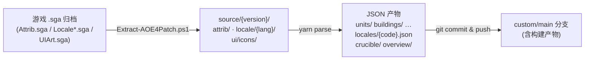

# 完整更新流程：解包 → 同步 → 构建 → 发布

本文档记录了从游戏文件解包原始数据、同步上游代码、构建 JSON 产物、到发布 `custom/main` 的完整操作流程。

## 数据管线总览



> 自上游 `aoe4world/data` 引入多语言管线后，中文等所有语言的翻译都由 `yarn parse` 统一从
> `source/latest/locale/{lang}/cardinal.{lang}.ucs` 读取，**不再需要单独手动解包中文语言包**。

---

## 前置条件

### 必需工具

| 工具 | 用途 | 安装方式 |
|------|------|----------|
| .NET Runtime 6.0 | 运行 AOEMods.Essence 解包工具 | https://dotnet.microsoft.com/zh-cn/download/dotnet/6.0 |
| AOEMods.Essence | 解包 .sga 游戏归档文件 | https://github.com/aoemods/AOEMods.Essence/releases |
| Node.js 20+ + Yarn | 运行 `yarn parse` 构建脚本 | `corepack enable` / `npm install -g yarn` |

### 游戏路径

以下假设游戏安装在 Steam 默认路径。请根据实际情况修改 `$GamePath` 变量：

```powershell
$GamePath = 'D:\SteamLibrary\steamapps\common\Age of Empires IV'
```

脚本会读取 `RelicCardinal.exe` 的版本号（例如 `17.0.12182`），并输出到 `source/{version}/`。

### Git 远程与别名（仅首次配置）

```bash
git remote add upstream https://github.com/aoe4world/data.git
git config --local pull.ff only
git config --local rerere.enabled true
git config --local alias.sync-upstream "!git fetch upstream && git switch main && git merge --ff-only upstream/main && git push origin main"
git config --local alias.refresh-custom "!git switch custom/main && git merge main && git push origin custom/main"
```

### 首次配置 AOEMods.Essence

从 [AOEMods.Essence Releases](https://github.com/aoemods/AOEMods.Essence/releases) 下载最新版，解压到 `./source/AOEMods.Essence/`，确保存在：

```
./source/AOEMods.Essence/AOEMods.Essence.CLI.dll
```

---

## 完整操作流程

### 第 1 步：解包游戏原始数据

以**管理员**身份打开 PowerShell，进入项目目录，设置执行策略：

```powershell
cd C:\Users\liumin\Documents\aoe4\aoe4data
Set-ExecutionPolicy -ExecutionPolicy Bypass -Scope Process
```

运行解包脚本：

```powershell
$GamePath = 'D:\SteamLibrary\steamapps\common\Age of Empires IV'
.\Extract-AOE4Patch.ps1 -GamePath $GamePath
```

脚本会依次完成：

1. `Attrib.sga` → `source/{version}/attrib-raw/rgd/`，再解码为 `source/{version}/attrib/*.json`（数值/属性源数据）；
2. **全部** `Locale*.sga` → `source/{version}/locale/{lang}/`（当前版本共 26 种语言，含 `zh-hans`）；
3. `UIArt.sga` → `source/{version}/uiart-raw/`，并把种族图标解码到 `source/{version}/ui/`；
4. 把 `source/latest` 重定向到 `source/{version}/`（Junction）。

可用参数（按需组合）：

| 参数 | 说明 |
|------|------|
| `-SkipAttrib` | 跳过 Attrib.sga（只更新语言/图标时使用） |
| `-SkipLocale` | 跳过所有 Locale*.sga |
| `-SkipIcons` | 跳过 UIArt.sga（**最省时间**，图标解包最慢） |
| `-NoJunction` | 不更新 `source/latest` 指向 |
| `-RemoveTemp` | 转换完成后删除 `attrib-raw` / `uiart-raw` 临时目录 |
| `-ExtractExtraImages` | 额外导出地图/文明旗帜/DLC 等图标 |

> **耗时参考**：`Attrib.sga` 约 3 分钟，`Locale*.sga`（26 个）约 2 分钟，`UIArt.sga`（1.8 GB）
> 在本机约 45–60 分钟（受杀毒软件/磁盘影响较大）。只做数值与文本更新时建议加 `-SkipIcons` 复用已有图标。

### 第 2 步：同步上游代码

```bash
git sync-upstream
```

等价于手动执行：

```bash
git fetch upstream
git switch main
git merge --ff-only upstream/main
git push origin main
```

> 若上游没有新提交，这一步只做一次 fetch 即可，不会产生改动。

### 第 3 步：将 feature 分支变基到最新 main

```bash
git switch feature/zh-hans-localized-fields
git rebase main
```

本 fork 在 main 之上只保留**少量移植提交**（中文字段 + `__game_version__`），因此冲突通常集中在：

```
src/attrib/parse.ts          src/attrib/run.ts
src/attrib/translations.ts   src/attrib/config.ts
src/lib/utils/items.ts       src/types/items.ts
src/types/civs.ts            src/sdk/data.ts
src/sdk/index.ts
```

#### 冲突处理原则

上游已经内置了完整的本地化体系（`locales/{code}.json`、`item.translations`、`localizeCiv*` 等），
所以**冲突文件一律以上游实现为准**，然后确认 fork 的增量仍然存在：

- 条目字段：`nameCN` / `descriptionCN` / `displayClassesCN`
- 文明字段：`nameCN` / `classesCN` / `descriptionCN` / `overviewCN`
- 元数据：`__game_version__` 与 SDK 的 `gameVersion` 导出

```bash
# 某个文件直接用上游版本
git checkout --ours -- <conflicted-file>
git add <conflicted-file>
git rebase --continue

# 若该提交的改动已被上游完全覆盖，可直接跳过
git rebase --skip
```

> `rebase --continue` 可能打开编辑器（vim）。建议先设置：
>
> ```powershell
> $env:GIT_EDITOR = 'true'
> ```
>
> 以免卡在编辑器中（表现为命令长时间无输出）。

### 第 4 步：推送更新后的 feature 分支

```bash
git push --force-with-lease origin feature/zh-hans-localized-fields
```

### 第 5 步：重建 custom/main

```bash
# 删除旧 custom/main（本地 + 远端）
git branch -D custom/main
git push origin --delete custom/main

# 从当前 feature 分支创建新的 custom/main
git switch -c custom/main
git push origin custom/main
```

> 之后日常同步也可以用别名 `git refresh-custom`（把 main 合并进 custom/main 并推送），
> 但发布新版本数据时建议按第 6-8 步重新构建。

### 第 6 步：执行构建

```bash
# 可选：数据量较大时提高 Node 堆内存
$env:NODE_OPTIONS = '--max-old-space-size=8192'

yarn parse
```

构建行为说明：

- 默认会把 `source/latest/locale/` 下**所有**有效语言（存在 `cardinal.{code}.ucs`）作为目标语言；
- 只构建部分语言：`yarn parse --locales zh-hans,en`（`-l` 同义）；
- 关闭所有翻译产物：`yarn parse --no-translations`（此时 `nameCN` 等字段回退为英文）；
- `--essence` 已废弃，`--civ` 已禁止使用。

构建过程中出现的以下日志**属于正常输出**，不影响结果：

- `Icon conflict at …`（同名图标被多个文明复用）
- `Duplicate item id …`（不同文明共享同一基础 ID）
- `Unknown float property …` / `Modifier with missing expected helptexts`（上游未识别的属性）

### 第 7 步：校验产物

```powershell
# 版本号应等于 source/latest 指向的目录名
python -c "import json;print(json.load(open('units/all-optimized.json',encoding='utf-8'))['__game_version__'])"

# 中文字段抽查
python -c "import json;u=json.load(open('units/abbasid/archer-2.json',encoding='utf-8'));print(u['name'],'/',u['nameCN'],'/',u['displayClassesCN'])"

# 语言包数量（26 种语言 + locale-index.json）
Get-ChildItem locales\*.json | Measure-Object
```

预期（17.0.12182）：`__game_version__` 为 `17.0.12182`，`nameCN` 为「步弓手」，
`locales/` 下 27 个 JSON，`git status` 变更文件约 6000+。

### 第 8 步：提交构建产物并发布

```bash
git add -A
git commit -m "build: update data files for 17.0.12182"
git push origin custom/main
```

### 第 9 步：回到 feature 分支

```bash
git switch feature/zh-hans-localized-fields
```

---

## 构建产物说明

| 路径 | 内容 |
|------|------|
| `units/` `buildings/` `technologies/` `upgrades/` `abilities/` | 每个文明子目录一份条目 JSON；另有 `all.json`、`all-unified.json`、`all-optimized.json`、`all-baseids.json`、`{civ}.json`、`{civ}-unified.json`、`{civ}-optimized.json` 与 `unified/{id}.json` |
| `civilizations/` | 各文明概览 `{slug}.json` 与 `civs-index.json` |
| `locales/` | 每种语言的翻译包 `{code}.json` + `locale-index.json`；`en.json` 为空壳（英文即条目本身的基础字段） |
| `crucible/` | `perks.json`、`boons.json`、`mutators.json`、`talent_perks.json` |
| `overview/` | `patch-history.json` |
| `images/` | 图标资源（按 `units`/`buildings`/… 分类） |
| `src/attrib/locale-overrides.json` | 游戏内缺失文本的补充翻译（维护说明见 `scripts/TRANSLATIONS.md`） |

每个产物的 meta 都包含：

```json
{ "__note__": "…", "__version__": "0.0.2", "__game_version__": "17.0.12182" }
```

### fork 专有字段（向后兼容）

为兼容尚未接入 `locales/` 的旧调用方，构建时会把简体中文再内嵌一份：

| 字段 | 位置 | 等价来源 |
|------|------|----------|
| `nameCN` / `descriptionCN` / `displayClassesCN` | 条目、`unified/*`、`all-unified`、文明条目 | `item.translations["zh-hans"]` |
| `nameCN` / `classesCN` / `descriptionCN` / `overviewCN` | `civilizations/*.json` | 文明 `translations["zh-hans"]` |
| `__game_version__` / SDK `gameVersion` | 所有产物 meta、`src/sdk` | `source/latest` 的目录名 |

> 若某条目在 `zh-hans` 中没有对应翻译，上述字段回退为英文原文。

---

## 仅同步代码（不重新解包）

游戏没有更新、只需要跟随上游代码时，跳过第 1 步：

```powershell
git sync-upstream
git switch feature/zh-hans-localized-fields
git rebase main
git push --force-with-lease origin feature/zh-hans-localized-fields
git branch -D custom/main
git push origin --delete custom/main
git switch -c custom/main
git push origin custom/main
yarn parse
git add -A
git commit -m "build: sync upstream and rebuild data"
git push origin custom/main
git switch feature/zh-hans-localized-fields
```

## 仅更新语言包

不需要重新解包数值时（例如只跟随游戏文本修正）：

```powershell
.\Extract-AOE4Patch.ps1 -GamePath $GamePath -SkipAttrib -SkipIcons
yarn parse
```

## 限定构建语言

`yarn parse` 会扫描 `source/latest/locale/*/cardinal.{code}.ucs`。若只想发布部分语言：

```powershell
# 方式一：删除不需要的语言目录（en 必须保留）
Remove-Item .\source\latest\locale\ja, .\source\latest\locale\ko -Recurse
yarn parse

# 方式二：命令行指定
yarn parse --locales en,zh-hans
```

> 注意：`nameCN` 等字段依赖 `zh-hans` 翻译；未包含 `zh-hans` 时会回退为英文。

---

## 一键脚本（无冲突时）

保存为 `update-all.ps1`，以管理员身份运行，按需修改 `$GamePath`：

```powershell
$ErrorActionPreference = 'Stop'
$GamePath = 'D:\SteamLibrary\steamapps\common\Age of Empires IV'
$env:GIT_EDITOR = 'true'
$env:NODE_OPTIONS = '--max-old-space-size=8192'
Set-ExecutionPolicy -ExecutionPolicy Bypass -Scope Process

# --- 第1步：解包（只更新文本时可加 -SkipIcons） ---
.\Extract-AOE4Patch.ps1 -GamePath $GamePath

# --- 第2-5步：同步上游、变基、推送 feature、重建 custom/main ---
git sync-upstream
git switch feature/zh-hans-localized-fields
git rebase main
git push --force-with-lease origin feature/zh-hans-localized-fields
git branch -D custom/main
git push origin --delete custom/main
git switch -c custom/main
git push origin custom/main

# --- 第6-8步：构建、提交、发布 ---
yarn parse
git add -A
git commit -m "build: update data files from upstream sync"
git push origin custom/main

# --- 第9步：回到 feature ---
git switch feature/zh-hans-localized-fields
```

---

## 分支结构说明

```
main  ───────────────────────── 最新上游 (aoe4world/data)
                                 └── feature/zh-hans-localized-fields (main + 移植提交)
                                      ├── nameCN / descriptionCN / displayClassesCN
                                      ├── 文明 nameCN / classesCN / descriptionCN / overviewCN
                                      ├── __game_version__ 与 SDK gameVersion
                                      └── 更新文档
custom/main ─────────────────── 与 feature 相同 + 该版本的构建产物
```

发布链路：`custom/main` 的内容即对外数据（`https://data.aoe4world.com/`），因此构建产物必须提交在该分支上。

---

## 常见问题

| 现象 | 原因 / 处理 |
|------|-------------|
| 构建中途退出（exit code 1），且 `git status` 无产物 | 构建期间切换/清理了分支或文件。`ts-node` 读取的文件被改动会导致失败；重新执行 `yarn parse` 即可 |
| `JavaScript heap out of memory` | 使用 `$env:NODE_OPTIONS = '--max-old-space-size=8192'` 后重试 |
| `nameCN` 全是英文 | `source/latest/locale/zh-hans/cardinal.zh-hans.ucs` 缺失；重新执行第 1 步（或用 `-SkipAttrib -SkipIcons` 只补语言包） |
| `source/latest` 指向错误版本 | 重新运行 `Extract-AOE4Patch.ps1`；Junction 会在脚本末尾更新 |
| 推送被拒绝（feature 已重写） | 使用 `--force-with-lease`；若远端有他人提交，先 `git fetch` 确认 |
| 图标缺失/旧图标 | 未解包 `UIArt.sga`（用了 `-SkipIcons`）。去掉该参数重新执行第 1 步 |
